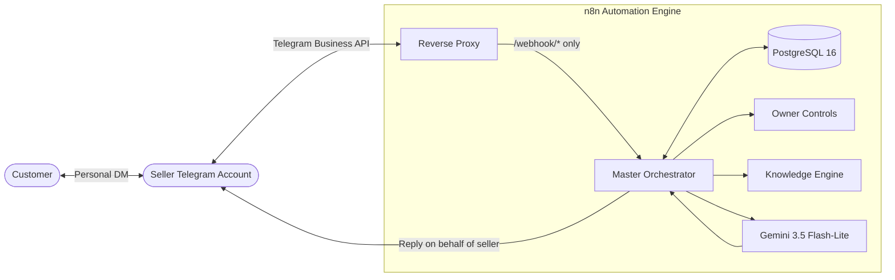

# AI Sales Agent

> **Autonomous AI Sales Assistant for Telegram Connected Business Accounts, powered by n8n, Google Gemini 3.5 Flash-Lite, and PostgreSQL.**

[](https://n8n.io)
[](https://www.postgresql.org/)
[](https://ai.google.dev/)
[](https://www.docker.com/)
[](LICENSE)

---

## Overview

The **AI Sales Agent** enables small businesses to automate customer inquiries directly within their **existing personal Telegram account** via the **Telegram Connected Business Bot** API. Customers chat directly with the seller's account—never an impersonal bot handle—while the agent provides instant, verified stock, pricing, shipping, and payment information in polite Filipino Taglish.

### Key Capabilities

- **Direct DM Operation**: Uses Telegram Business connections to read and reply on behalf of the seller in the customer's personal DM thread.
- **Zero-Hallucination Catalog Engine**: Real-time product retrieval and fuzzy matching across 69 items and 13 members in PostgreSQL, strictly quoting Philippine Pesos (`₱`).
- **Grounded AI Conversations**: Powered by **Gemini 3.5 Flash-Lite** with strict safety boundaries, packaging fee tiers, shipping rate math, and automated disclosure tags.
- **Human Takeover & Control**: Automatically pauses AI when the seller sends a manual message in a customer DM. Full seller control via `/on`, `/off`, `/status`, and `/pause` commands.
- **Production Hardening**: Reverse proxy routing that protects the n8n admin UI with HTTP 403, atomic update deduplication in PostgreSQL, and infinite loop suppression.

---

## Architecture



---

## Owner Control Commands

Manage the agent in real time by messaging the bot from your Telegram account:

| Command | Scope | Description |
| :--- | :--- | :--- |
| `/status` | Global | Check agent state (`ON`/`OFF`), active paused chats, and catalog size. |
| `/on` | Global | Enable automated replies for incoming inquiries. |
| `/off` | Global | Instantly disable automated replies. |
| `/pause [chat_id]` | Per-Chat | Mute AI for a specific customer without affecting other chats. |
| `/resume [chat_id]`| Per-Chat | Unmute AI for a specific customer. |
| *Manual Typing* | Per-Chat | **Human Takeover**: If the seller sends a manual DM to a customer, AI auto-pauses for that chat. |

---

## Quickstart (Local Development)

### Prerequisites
- [Docker Desktop](https://www.docker.com/) (running on Windows, macOS, or Linux)
- Git and PowerShell 5.1+ (Windows) or Bash (macOS/Linux)

### 1. Initialize Configuration
```bash
cp .env.example .env
```
Fill in `.env`:
- `TELEGRAM_BOT_TOKEN`: From `@BotFather`
- `TELEGRAM_SELLER_USER_ID`: Numeric Telegram ID
- `GEMINI_API_KEY`: From Google AI Studio
- `GEMINI_MODEL`: `gemini-3.5-flash-lite`

### 2. Start Services & Sync Knowledge Base
```bash
docker compose up -d
powershell -ExecutionPolicy Bypass -File ./scripts/sync-knowledge.ps1
```

### 3. Run Acceptance Test Suite
```bash
powershell -ExecutionPolicy Bypass -File ./scripts/test-acceptance-suite.ps1
```

---

## Production Deployment

The project includes ready-to-run configurations for **Oracle Cloud Always Free ARM64** instances (`VM.Standard.A1.Flex`):

- **Automated TLS**: Caddy reverse proxy handles automated Let's Encrypt certificates.
- **Security**: n8n admin port `5678` is bound to `127.0.0.1` and accessed privately via SSH tunnel (`ssh -N -L 5678:localhost:5678 user@ip`).
- **One-Click Deploy**: Run `./scripts/deploy-oracle.sh`.

See the complete production setup guide in [**`DEPLOYMENT.md`**](DEPLOYMENT.md).

---

## Verification & Testing Matrix

| Test Suite | Scope | Status | Details |
| :--- | :--- | :---: | :--- |
| **Phase 3** | Docker Infrastructure & PostgreSQL | `PASS` | Healthy containers with persistent volumes |
| **Phase 4** | Webhook Proxy Security | `PASS` | `/webhook/*` routed; admin endpoints return 403 |
| **Phase 5** | Knowledge Base Retrieval | `PASS` | 6/6 tests passed (exact match, aliases, typos, OOS) |
| **Phase 6** | Gemini 3.5 Sales Dialogue | `PASS` | 5/5 multi-turn scenarios passed with zero hallucination |
| **Phase 7** | Owner Controls & Human Takeover | `PASS` | 6/6 tests passed (`/on`, `/off`, `/pause`, manual typing) |
| **Phase 8** | Reliability & Deduplication | `PASS` | Atomic database constraint & loop prevention |
| **Live TG** | Telegram Business DM Reply | `DEFERRED` | Verified with fixtures; runs on Oracle Cloud VM |

---

## Backup & Maintenance

- **Create Backup**: `./scripts/backup.sh` (or `.\scripts\backup.ps1`)
- **Restore Database**: `./scripts/restore.sh backups/<backup_file>.sql`
- **View Logs**: `docker compose logs -f n8n`

---

## License

This project is licensed under the MIT License.
