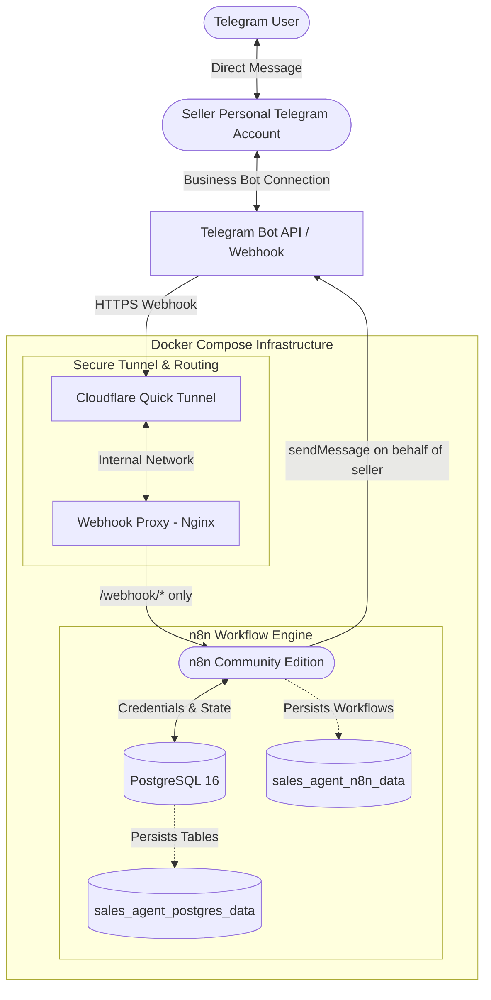

# AI Sales Agent — Telegram + n8n + Gemini

An automated AI Sales Agent designed for a Philippine small business. The system integrates a personal Telegram seller account (via Telegram Connected Business Bot) with Google Sheets for real-time inventory and pricing lookup, and Google Gemini Flash-Lite for verified, context-aware customer service and sales conversations.

---

## 1. Architecture Overview



### End-to-End Conversation Flow (Phase 4):
1. **Inbound Message**: Customer sends a direct message to the seller's personal Telegram account.
2. **Business Bot Dispatch**: Telegram forwards the update (`business_message` or `business_connection`) to the registered public webhook.
3. **Public Ingress Protection**: Cloudflare Quick Tunnel forwards the request to the `webhook_proxy` container. Nginx verifies the path:
   - `/webhook/*` and `/webhook-test/*` are forwarded to n8n.
   - All other routes (Admin UI, credentials, REST APIs) are strictly blocked with `403 Forbidden`.
4. **Secret Token Verification**: n8n validates the `X-Telegram-Bot-Api-Secret-Token` header.
5. **Event Routing**: Routes `business_message`, `business_connection`, or standard direct `message` updates.
6. **Message Normalization**: Normalizes incoming payloads to a clean schema (`update_id`, `business_connection_id`, `chat_id`, `sender_id`, `message_id`, `text`, `timestamp`).
7. **Authorization & Safety Filter**:
   - `TELEGRAM_TEST_MODE` must be `true`.
   - Message must contain valid text and a valid `business_connection_id`.
   - Outgoing messages typed by the seller (`sender_id == TELEGRAM_SELLER_USER_ID`) are discarded.
   - Bot-generated messages are discarded.
   - Chat ID must exist in `TELEGRAM_ALLOWED_TEST_CHAT_IDS`.
8. **Deduplication Check**: Queries PostgreSQL (`telegram_processed_updates`) to ensure atomic delivery without duplicate responses.
9. **Automated Response**: Sends the predefined response on behalf of the seller:
   > *"Hii po! 💗 This is Sash's automated shop assistant. We're currently testing our automatic replies!"*

---

## 2. Infrastructure & Repository Structure

```
├── .env.example                     # Environment template with Phase 4 Telegram variables
├── .gitignore                       # Protects credentials, logs, and database dumps
├── docker-compose.yml               # Multi-container orchestration (n8n, postgres, proxy, cloudflared)
├── Product Info.csv                 # Source product catalog & pricing (Phase 0)
├── README.md                        # Project documentation and operational guide
├── backups/                         # Database and workflow backup snapshots
├── proxy/
│   └── nginx.conf                   # Reverse proxy restricting public access to webhooks only
├── scripts/                         # Automation & maintenance scripts
│   ├── init-env.ps1 / .sh           # Secret token and environment initialization
│   ├── init-tables.ps1 / .sh        # PostgreSQL tables initialization for state & deduplication
│   ├── start-tunnel.ps1 / .sh       # Starts Cloudflare Tunnel, updates WEBHOOK_URL, and reloads n8n
│   ├── register-webhook.ps1 / .sh   # Registers Telegram Webhook with secret token & business updates
│   ├── import-workflow.ps1 / .sh    # Imports Phase 4 workflow JSON into n8n
│   ├── backup.ps1 / .sh             # Database SQL dump and workflow export
│   ├── verify-phase3.ps1            # Phase 3 local infrastructure test suite
│   └── verify-phase4.ps1            # Phase 4 Telegram integration test suite
└── workflows/
    ├── .gitkeep
    ├── README.md
    └── telegram_business_agent.json # Version-controlled Phase 4 n8n workflow
```

---

## 3. Configuration & Telegram Setup

### Step 1: Configure `.env` Credentials
Open `.env` (or run `./scripts/init-env.ps1`) and populate:

```env
# Bot Token from @BotFather for the Connected Business Bot
TELEGRAM_BOT_TOKEN=123456789:ABCdefGhIJKlmNoPQRstuVWXyz

# Seller's Telegram User ID (obtained via @userinfobot or message payload)
TELEGRAM_SELLER_USER_ID=987654321

# Secret Token for Webhook Verification (Auto-generated by init-env.ps1)
TELEGRAM_WEBHOOK_SECRET=your_32_byte_random_secret

# Development Safety Controls
TELEGRAM_TEST_MODE=true
TELEGRAM_ALLOWED_TEST_CHAT_IDS=1122334455
```

### Step 2: Configure Telegram Credentials in n8n
1. Open n8n locally at [http://localhost:5678](http://localhost:5678).
2. Go to **Credentials** -> **New Credential**.
3. Select **Telegram API**.
4. Paste your `TELEGRAM_BOT_TOKEN` and save as `Telegram Sales Agent Account`.

---

## 4. Local Webhook & Tunnel Management

Telegram requires an HTTPS endpoint with a valid TLS certificate. The local stack uses a Cloudflare Quick Tunnel paired with an Nginx reverse proxy.

### Starting / Restarting the Tunnel
```powershell
./scripts/start-tunnel.ps1
```
*(On Linux/macOS: `./scripts/start-tunnel.sh`)*

This script:
1. Starts the `sales_agent_webhook_proxy` and `sales_agent_tunnel` containers.
2. Extracts the assigned `https://*.trycloudflare.com` URL.
3. Automatically updates `WEBHOOK_URL` in `.env`.
4. Restarts `sales_agent_n8n` to bind the new webhook URL.

> [!IMPORTANT]
> Cloudflare Quick Tunnels are ephemeral and generate a new URL upon container restart. Whenever the tunnel restarts, re-register the webhook using Step 5.

### Step 5: Registering the Webhook with Telegram
```powershell
./scripts/register-webhook.ps1
```
This registers the active tunnel URL with Telegram using `setWebhook`:
- URL: `https://<assigned-tunnel>.trycloudflare.com/webhook/telegram-business`
- Allowed Updates: `["business_connection", "business_message", "edited_business_message", "message"]`
- Secret Token: Protected with `X-Telegram-Bot-Api-Secret-Token` header.
- Drops any pending stale updates.

---

## 5. Live Testing & Verification Procedure

Follow these steps to conduct a live end-to-end verification:

1. **Verify Services**:
   ```powershell
   ./scripts/verify-phase4.ps1
   ```
2. **Import Workflow**:
   ```powershell
   ./scripts/import-workflow.ps1
   ```
3. **Verify Activation in n8n**:
   - Open [http://localhost:5678](http://localhost:5678).
   - Verify that **Phase 4 - Telegram Business Sales Agent** is active.
4. **Send Test Message**:
   - From an authorized test Telegram account (`TELEGRAM_ALLOWED_TEST_CHAT_IDS`), send a private DM to the seller's personal Telegram account:
     > *"Hello, are you open today?"*
5. **Verify Reply**:
   - Within 1–2 seconds, the automated reply will arrive in that **same personal DM** from the seller:
     > *"Hii po! 💗 This is Sash's automated shop assistant. We're currently testing our automatic replies!"*
6. **Safety Validation**:
   - Send a message from an unlisted account: verify **no reply** is sent.
   - Reply as the seller: verify **no reply loop** occurs.
   - Resend identical update: verify deduplication table catches it.

---

## 6. Known Restrictions & Telegram Business Rules

- **24-Hour Reply Window**: Bots connected to a Telegram Business account can reply to private chats within 24 hours of the customer's last message.
- **Connection Permissions**: The business bot connection must maintain the `can_reply: true` permission.
- **Outgoing Message Filtering**: In Telegram Business, both incoming customer messages and outgoing seller messages generate `business_message` updates. The `sender_id != TELEGRAM_SELLER_USER_ID` filter prevents recursive message loops.
- **Ephemeral Tunnels**: For production, an Oracle Cloud VM with a static public IP and standard Let's Encrypt TLS certificate replaces the local Cloudflare Quick Tunnel.

---

## 7. Next Development Phase

- **Phase 5: Knowledge Base & Inventory Query Engine**:
  - Connect Google Sheets product catalog, shipping fees, and payment information.
  - Implement caching in PostgreSQL for instant inventory lookups.
  - Implement keyword and SKU matching.
