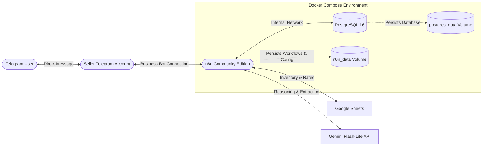

# AI Sales Agent — Telegram + n8n + Gemini

An automated AI Sales Agent designed for a Philippine small business. The system integrates a personal Telegram seller account (via Telegram Business Bot connection) with Google Sheets for real-time inventory and pricing lookup, and Google Gemini Flash-Lite for verified, context-aware customer service and sales conversations.

---

## 1. Architecture Overview



### End-to-End Conversation Flow:
1. **Inbound Message**: Customer sends a direct message to the seller's personal Telegram account.
2. **Telegram Business Connection**: Telegram forwards the message event to the connected Telegram Business Bot.
3. **Automation Gate**: n8n intercepts the webhook and verifies if automated handling is active for this chat/customer.
4. **Data Retrieval**: n8n looks up current product availability, prices, shipping rates, and payment methods from Google Sheets.
5. **AI Generation**: n8n invokes Gemini 2.0 Flash-Lite with the business rules, strict inventory data, and conversation history.
6. **Outbound Response**: The verified response appears seamlessly in the original Telegram DM from the seller's account.

---

## 2. Infrastructure & Repository Structure

The local development infrastructure runs on Docker Desktop (Windows/Linux/macOS) and is designed to deploy seamlessly to an Oracle Cloud Always Free ARM64 Linux VM without modifications.

```
├── .env.example          # Environment variable template with security notes
├── .gitignore            # Protects credentials, logs, and database dumps
├── docker-compose.yml    # Orchestrates n8n and PostgreSQL containers
├── Product Info.csv      # Source product catalog & pricing (Phase 0)
├── README.md             # Project documentation and operational guide
├── backups/              # Directory for database SQL dumps (git-ignored)
│   └── .gitkeep
├── scripts/              # Infrastructure automation scripts
│   ├── init-env.ps1      # PowerShell environment initialization & secret generator
│   ├── backup.ps1        # PowerShell PostgreSQL dump & workflow export script
│   └── backup.sh         # Linux/macOS bash equivalent backup script
└── workflows/            # Version-controlled n8n workflow JSON exports
    ├── .gitkeep
    └── README.md         # Guide for workflow export and import
```

### Component Details:
- **n8n Community Edition**: Pinned stable release (`docker.n8n.io/n8nio/n8n:2.44.6`). Accessible locally at `http://127.0.0.1:5678`.
- **PostgreSQL**: Pinned stable release (`postgres:16-alpine`). Dedicated database storage for n8n workflows, execution states, and credentials. Internal Docker network only; not exposed to the host machine.
- **Persistent Volumes**: Named Docker volumes (`sales_agent_n8n_data` and `sales_agent_postgres_data`) ensure data survives container restarts and upgrades.
- **Internal Network**: `sales_agent_net` (bridge) isolates inter-container communication.

---

## 3. Configuration Instructions

### Step 1: Initialize Environment File
Run the initialization script to create `.env` from `.env.example` with cryptographically secure random keys:

**Windows (PowerShell):**
```powershell
./scripts/init-env.ps1
```

**Linux / macOS:**
```bash
cp .env.example .env
# Set a 32-byte hex encryption key:
sed -i "s/replace_with_32_byte_hex_encryption_key/$(openssl rand -hex 32)/" .env
# Set a strong PostgreSQL password:
sed -i "s/replace_with_secure_postgres_password/$(openssl rand -hex 16)/" .env
```

### Step 2: Configure Secrets in `.env`
Open `.env` and verify the following variables:
- `N8N_ENCRYPTION_KEY`: Persistent 32-byte hexadecimal encryption key. **Do not change or lose this key once credentials are saved in n8n.**
- `POSTGRES_PASSWORD`: Strong password for the PostgreSQL user.
- `GEMINI_API_KEY`: Google Gemini API key obtained from Google AI Studio.
- `GENERIC_TIMEZONE` & `TZ`: Set to `Asia/Manila` (PHT, UTC+8).
- `EXECUTIONS_DATA_PRUNE`: Set to `true` with a 7-day max retention (`168` hours) to avoid unbounded database growth.

---

## 4. Local Startup & Management

### Starting Services
Start the containers in detached mode:
```powershell
docker compose up -d
```
Docker Compose will start PostgreSQL, wait for its healthcheck (`pg_isready`) to pass, and then launch n8n.

### Checking Service Status & Health
```powershell
docker compose ps
```
Both `sales_agent_postgres` and `sales_agent_n8n` should display `Up (healthy)`.

### Viewing Logs
```powershell
# Follow all logs
docker compose logs -f

# Follow n8n logs only
docker compose logs -f n8n

# Follow PostgreSQL logs only
docker compose logs -f postgres
```

### Accessing n8n Web Interface
Open your web browser and navigate to:
```
http://localhost:5678
```
*(or `http://127.0.0.1:5678`)*

On first access, n8n will prompt you to set up the **Owner Account** (admin user email and password).

### Stopping Services
To stop running containers gracefully:
```powershell
docker compose stop
```

To stop and remove containers (preserving all volume data):
```powershell
docker compose down
```

> [!WARNING]
> Never run `docker compose down -v` unless you intentionally want to delete all database records, credentials, and workflow configurations.

---

## 5. Data Persistence & Backup Procedures

### Persistence Verification
All application data is isolated into named Docker volumes:
- `sales_agent_n8n_data`: Contains `/home/node/.n8n` (encryption keys, internal settings, SQLite cache if any).
- `sales_agent_postgres_data`: Contains `/var/lib/postgresql/data` (PostgreSQL tables, workflow schemas, execution logs).

### Automated Backup Script
Run the automated backup script to take a snapshot of the PostgreSQL database and export all active workflows to JSON:

**Windows (PowerShell):**
```powershell
./scripts/backup.ps1
```

**Linux / macOS / Oracle VM:**
```bash
./scripts/backup.sh
```

Backups are saved to:
- `backups/n8n_db_<TIMESTAMP>.sql` (PostgreSQL dump)
- `workflows/workflows_<TIMESTAMP>.json` (Workflow definitions)

---

## 6. Known Limitations

- **Local Webhook Reachability**: Telegram requires HTTPS webhooks with public endpoints. For Phase 4/5 integration testing, a secure tunnel (e.g., Cloudflare Tunnel or ngrok) or direct deployment to the Oracle Cloud VM with a public IP/domain and TLS certificate will be required.
- **Single-Node Community Edition**: Built using the official n8n Community Edition without paid enterprise/source-control features. Workflows are version-controlled via JSON exports in `workflows/`.
- **First-Run Manual Interaction**: The n8n owner account must be initialized manually via the web browser upon first launch.

---

## 7. Next Development Phase

- **Phase 4: Core Automation Workflow**:
  - Implement Telegram Business Bot webhook receiver in n8n.
  - Implement Seller vs. Customer routing logic.
  - Integrate Google Sheets node for dynamic inventory and shipping fee queries.
  - Integrate Gemini Flash-Lite LLM node with structured system prompting.
  - Send verified replies back through the Telegram Business Bot connection.
